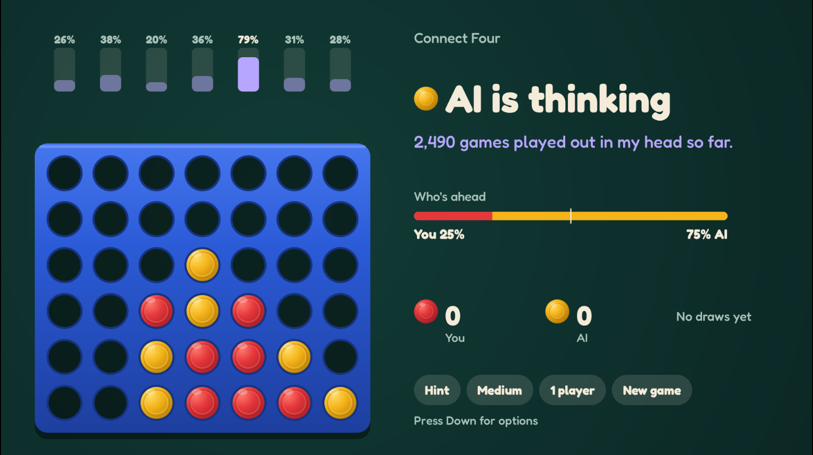
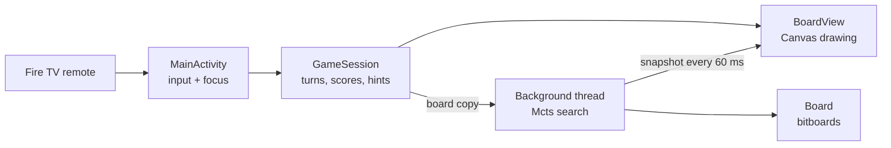

# Connect Four AI for Fire TV

**A living-room Connect Four game for Fire TV, played with the remote, against an AI you can watch think.**
While the AI searches, a bar above each column shows its live chance of winning there. After every move it says what it played and how confident it is.

<!-- SCREENSHOT: main gameplay shot (AI thinking, bars visible). Save it as docs/screenshots/gameplay.png, then delete the comment markers around the next line. -->
<!--  -->

<!-- DEMO VIDEO: paste the YouTube link below, then delete the comment markers. -->
<!-- **[Watch the 2-minute demo](https://youtu.be/YOUR-VIDEO-ID)** -->

Built for Amazon's *Build, Ship, Shape* Developer Hackathon (Fire TV track), October 2026.

## Highlights
- **An AI that explains itself.** Live win-chance bars while it thinks, a plain-English sentence after each move ("I played column 3. I give myself 48%."), and a red-versus-yellow *Who's ahead* bar.
- **Monte Carlo tree search** on a **bitboard** engine, simulating roughly **1 million games per second** on a laptop.
- **Built for a TV stick:** search runs off the UI thread, is capped at 400,000 tree nodes (~36 MB), and can be cancelled within 100 ms.
- **Fully remote-driven:** every feature works with the D-pad and Select. 1 player (Easy, Medium, Hard, Adaptive) or 2 players, hints, rematches with alternating first move.
- **37 automated tests**, including 3,000 random games replayed move by move against an independent reference implementation.
- **Zero dependencies:** plain Java and the Android SDK, nothing else.

<!-- SCREENSHOTS: add two or three more (a hint, the button row, a win) as docs/screenshots/*.png, then delete the comment markers around this table. -->
<!--
| Hint | Options | Win |
| --- | --- | --- |
|  |  |  |
-->

## How the AI works

### The board: two 64-bit numbers
Instead of a 7×6 array, the board is stored as two `long`s ("bitboards"): one with a bit for every disc on the board, one with a bit for every disc belonging to the player to move. Each column gets 7 bits, 6 cells plus an empty sentinel bit, so lines can't wrap between columns.

- **Dropping a disc** is a single addition: adding a column's bottom bit carries up to the first empty cell.
- **Finding four in a row** takes about a dozen bit operations: shift the board by 1 (vertical), 7 (horizontal), 6 or 8 (diagonals) and AND it with itself.
- **Switching turns** is one XOR.

That speed is what makes the next part possible. See [`Board.java`](engine/src/main/java/com/yuvraj/connect4/engine/Board.java).

### The search: Monte Carlo tree search (UCT)
The AI has no hand-written strategy. For every move it repeats four steps thousands of times:

1. **Select:** walk down the tree of explored moves, balancing moves that have won often against moves that haven't been tried much (the UCT formula).
2. **Expand:** add one untried move.
3. **Simulate:** play the rest of the game randomly.
4. **Back-propagate:** credit the win, draw or loss to every move on the path, from each player's point of view.

The most-visited move wins, and each column's win rate is exactly what the TV draws as bars. Two safety rules sit on top: always take an immediate win, otherwise block the opponent's. Difficulty is simply how many games it simulates per move: Easy 300, Medium 3,000, Hard 30,000. Adaptive doubles that after you win and halves it after you lose. See [`Mcts.java`](engine/src/main/java/com/yuvraj/connect4/engine/Mcts.java).

### Architecture

`GameSession` holds all game logic with no Android code, so it is tested on a plain JVM. The app and the tests compile the exact same engine source.

## Results
Measured by the test suite on a laptop CPU:

| Check | Result |
| --- | --- |
| Automated tests | 37 of 37 pass |
| Board correctness | 3,000 random games match a reference implementation move by move |
| Tactics | Always wins or blocks in 80 generated positions, even with 1 simulation |
| Speed | ~0.8 to 1.2 million simulated games per second |
| Strength vs a random player (2,000 simulations) | 20 of 20 games won |
| Hard vs Easy-level search (20,000 vs 500 simulations) | 18 of 20 games won |
| Cancelling a search | Stops within 100 ms |

## Run it

### The app (no Fire TV device needed)
1. Install Android Studio. In **Device Manager → Create Virtual Device → TV → Television (1080p)**, pick an API 34 image and start it.
2. **File → Open** this folder and let Gradle sync.
3. Press **Run ▶**. The app opens on the TV emulator.

**Controls:** Left/Right choose a column, Select drops, Up asks for a hint, Down opens the button row (Hint, difficulty, 1 or 2 players, New game). Up or Back returns to the board. On a keyboard: arrows, Enter, H, D, M, N.

### The tests (Java 17+)
```bash
./verify.sh          # all 37 tests
./verify.sh --fast   # skips the slower strength games
```

## Project structure
| Path | What |
| --- | --- |
| `app/` | Fire TV app: `MainActivity` (remote input, background search) and `BoardView` (all drawing) |
| `engine/.../engine/` | `Board` (bitboards), `Mcts` (search), difficulty levels |
| `engine/.../game/` | `GameSession`: turns, cursor, AI and hint jobs, scores |
| `tests/` | Dependency-free test suite and reference board |
| `verify.sh` | Compiles the engine and runs the tests |

## Tech
Java 17, Android SDK (Fire OS, minSdk 25), Android Canvas, Gradle, Monte Carlo tree search, bitboards.

## License
Code: MIT (see `LICENSE`). The Fredoka font in `app/src/main/assets/fonts` is under the SIL Open Font License (`OFL.txt`).
